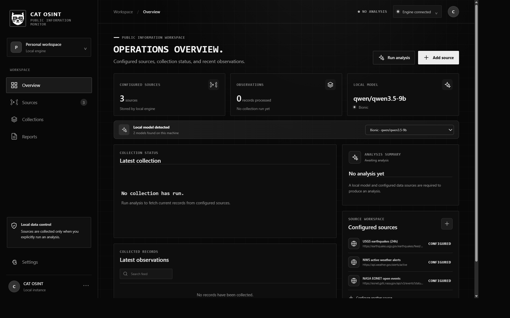
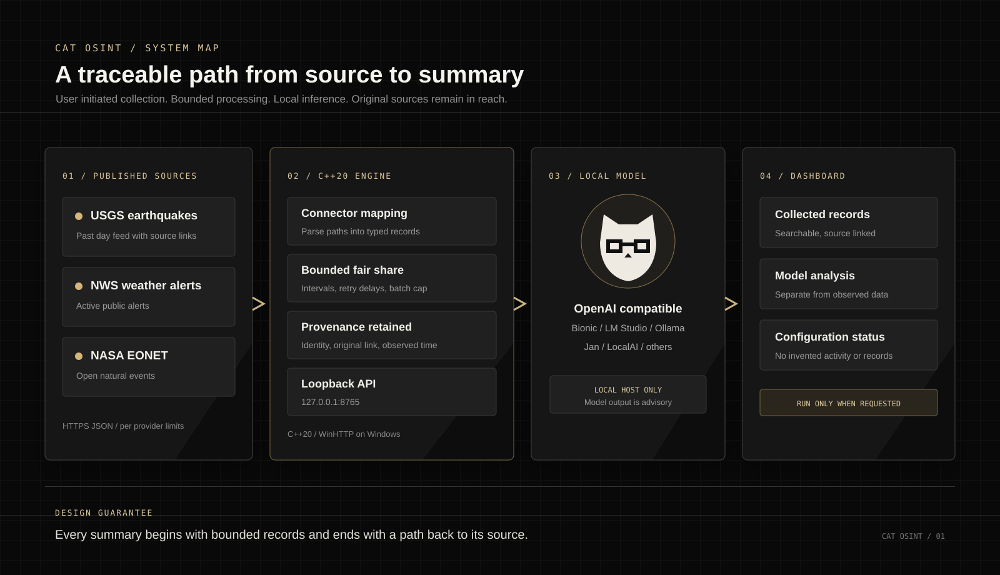

<div align="center">
  
  <h1>CAT OSINT</h1>
  <p><strong>A local research workspace for public information.</strong></p>
  <p>Collect structured records. Keep their source attached. Analyze them with a model running on your own machine.</p>
  <p>
    <a href="#system-design">System design</a> ·
    <a href="#quick-start">Quick start</a> ·
    <a href="#data-sources">Data sources</a> ·
    <a href="#local-models">Local models</a>
  </p>
</div>

<p align="center">
  
</p>

## What this project does

CAT OSINT is a C++20 collection and analysis engine with a React and TypeScript dashboard. It connects documented public JSON feeds to a bounded local analysis workflow. Each collected record carries its source identity, original link, and observation time into the analysis request.

The distinction between collection and interpretation is deliberate. The engine maps provider responses into records. A local language model can then summarize a user initiated batch. The dashboard presents those records and the model output separately so readers can return to the original source and judge the summary for themselves.

The project is designed for technical users who want to inspect the data path, change a connector, test a parser, or understand exactly what the model received. It is not a universal API crawler, a background surveillance system, or a substitute for source verification.

## The dashboard

The overview reports the engine connection, model availability, configured feeds, collection results, and analysis status. Empty states are intentional. Records and reports appear only after a real collection and analysis run; the interface does not fill quiet areas with invented activity.

The screenshot above shows the actual application with a local Bionic model discovered and three configured public feeds. No collection has been run in the screenshot, so the record area is correctly empty.

## System design

<p align="center">
  
</p>

### A single analysis run

The user starts a run from the dashboard. The C++ engine requests a bounded number of records from connectors whose polling intervals permit another request. A fair share of the remaining batch is offered to each ready source, so one busy feed cannot take the whole batch. The engine maps configured JSON paths, retains attribution, truncates oversized record content, and sends the selected records to the chosen local model.

The model returns text, not verified facts. CAT OSINT keeps the records and source links alongside that text. People must verify consequential claims against the original publisher.

### Network boundaries

The dashboard talks to the engine at `127.0.0.1:8765`. Model discovery and inference are restricted to loopback addresses. The engine does not scan other machines or enumerate running processes. Public data connectors use HTTPS, respect configured request intervals and provider retry delays, and do not bypass authentication, access controls, or rate limits.

On Windows, public API requests use WinHTTP and the system proxy configuration. IPv4 and IPv6 transport use the Windows network stack. Local model requests do not go through a public proxy.

## Data sources

CAT OSINT currently configures three public feeds by default. Collection is initiated by the user; the dashboard does not continuously fetch these feeds in the background.

| Source | Current feed | Record mapping |
| --- | --- | --- |
| [USGS earthquakes](https://earthquake.usgs.gov/earthquakes/feed/v1.0/summary/all_day.geojson) | All earthquakes from the past day | Event title, identifier, and USGS detail link |
| [National Weather Service](https://api.weather.gov/alerts/active) | Active weather alerts | Alert headline, description, identifier, and source link |
| [NASA EONET](https://eonet.gsfc.nasa.gov/api/v3/events?status=open&limit=100) | Open natural events, limited to 100 per request | Event title, identifier, and EONET link |

Additional HTTPS JSON endpoints can be added in Settings. A connector describes the endpoint, the array or object path containing records, and the fields to map into a record. APIs with complex pagination, authentication exchanges, or non JSON protocols need a dedicated connector.

The default feeds are a small, reviewable starting set. Public APIs have different schemas, terms, credentials, limits, and update schedules. There is no reliable way to discover and use every API on the internet automatically.

## Local models

The engine periodically checks known loopback model server endpoints, including LM Studio, Ollama, Bionic, Jan, GPT4All, LocalAI, llama.cpp, text-generation-webui, and KoboldCpp. Bionic's default API port is `1235`. Root URLs and OpenAI compatible `/v1` URLs are accepted by discovery.

The model must be exposed through an API that provides a model list and an OpenAI compatible chat completion route. A model being open in a desktop chat window does not by itself make it available to CAT OSINT. API keys for manually configured data sources are held in the running engine's memory and are not returned by the source listing endpoint.

## Quick start

### Build the C++ engine

Requirements are CMake 3.20 or newer and a C++20 compiler. The first CMake configure downloads the pinned header only JSON dependency and the HTTP server library.

```powershell
cmake -S . -B build -DBUILD_TESTING=ON
cmake --build build --config Release
ctest --test-dir build -C Release --output-on-failure
```

For a Visual Studio multi configuration build, start the engine with:

```powershell
.\build\Release\cat-osint.exe --serve
```

For a single configuration NMake build, the executable is normally `.\build\cat-osint.exe`.

### Start the dashboard

In another terminal:

```powershell
cd frontend
npm ci
npm run dev
```

Open the Vite URL printed in the terminal. The dashboard checks the local engine and discovers models automatically. Choose a detected model, review the configured sources, then run analysis when ready.

The production dashboard can be built with `npm run build` and checked with `npm run lint` from the `frontend` directory.

## Local API

The engine exposes a small versioned API on loopback.

| Method | Route | Purpose |
| --- | --- | --- |
| `GET` | `/api/v1/health` | Engine health |
| `GET` | `/api/v1/models` | Discover local models |
| `GET` | `/api/v1/sources` | List configured sources |
| `POST` | `/api/v1/sources` | Add a JSON source |
| `POST` | `/api/v1/analyze` | Fetch a bounded batch and analyze it |
| `GET` | `/api/v1/observations` | Read records from the latest run |

Requests that collect source data are explicit. Opening the dashboard only checks engine, model, and source configuration status.

## Project map

| Path | Responsibility |
| --- | --- |
| `src/core` | Batch limits, per source intervals, and analysis orchestration |
| `src/connectors` | Configurable HTTPS JSON source mapping |
| `src/models` | Local model discovery and chat completion adapter |
| `src/net` | HTTP transport and loopback restrictions |
| `src/api` | Local engine API and default feed registration |
| `frontend/src` | React dashboard and local engine client |
| `tests` | Focused C++ engine and connector tests |
| `docs/assets` | Project architecture graphic and application screenshots |

## Engineering principles

**Source first.** Preserve source identifiers, original links, and observed times so model summaries can be checked.

**Bounded work.** Limit record count and content length per analysis, respect provider polling intervals, and honor longer retry instructions.

**Local inference.** Send analysis requests only to a loopback model endpoint. Keep provider credentials out of URLs and source code.

**Visible uncertainty.** Treat model output as an interpretation that may be incomplete or wrong. It is not an authoritative incident report.

**Small components.** Keep deterministic parsing and batch management separate from network connectors and model prompts.

## Current scope

The current implementation supports public JSON feeds and local OpenAI compatible chat completion servers. Durable history, advanced provider specific pagination, broader export formats, and additional reviewed connectors remain future work. The tool does not promise second by second coverage; source publication schedules, network conditions, hardware, and model inference time determine freshness.

Contributions are welcome. A useful connector proposal identifies the provider, its published API documentation, terms of use, authentication method, rate limits, record fields, and source attribution behavior.

## License

CAT OSINT is licensed under the MIT License. See [LICENSE](./LICENSE) for the full text.
